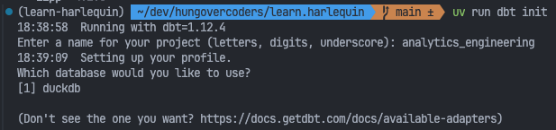

# Part 2 — DuckDB and DBT: Bringing rigour and environments to your delightful local data engineering

Time to increment to the next level now we have completed [part 1](./1.duckdb_harlequin.md), which tantalised us with a better future of non-hair tearing data engineering development on our local machines. These next steps will allow you to bring environmental awareness and pipeline testing to your setup - with duckdb and dbt!

## Installation

All we have to do to bring dbt into the mix is run the following command:

```bash
uv add dbt-duckdb
```

What did you have me install this time datagriff? Well hungovercoder we all know and love duckdb now, so what is dbt?

### DBT

DBT stands for ...
It is a ...

## Initialising DBT Project

Next run the following command:

```bash
uv run dbt init
```

Which will ask for some details to start your dbt project:



You'll then get a gnarly looking and obviously far more professional (and complicated!) directory layout compared to our first iteration. Hold on there reader, it'll be worth it.

### DBT Directories and Files I need to Know Right Now

Keeping in the spirit of simplicity, we're going to focus on only what we need right now to get going. Delete the analyses, macros, seeds and snapshots directories. You can look at the dbt docs here for more information. Your dbt directory structure should look something like this now:

#### Models

#### dbt_project.yml

#### profiles.yml

This will become important for when we want to deploy to a new environment - coming in part 3!

## Models Setup

Our models directory should end up looking something like this for the demo:

```txt
models/
├── sources/
│   └── raw_sources.yml
├── staging/
│   ├── stg_events.sql
│   └── staging.yml
└── marts/
    ├── fct_daily_event_summary.sql
    └── marts.yml
```

### Stable Source with Dynamic Location

In models/sources add the following code to the file raw_source.yml:

```yaml
version: 2

sources:
  - name: raw
    tables:
      - name: events
        config:
          external_location: "{{ env_var(
            'EVENTS_LOCATION',
            'data/raw/events/*.parquet'
          ) }}"
```

This starts adding the environmental awareness in to our dbt setup. We can now reference a table called events consistently in our other scripts but the actual location can change now per environment based on the environment variable. This means wee can use a local directory for local development in `EVENTS_LOCATION` and later use say an AWS S3 url for dev and production.

### Create Stable Views

In models/staging add the following code the file stg_events.sql:

```sql
{{ config(materialized='view') }}

select
  event_id,
  cast(event_timestamp as timestamp) as event_timestamp,
  cast(event_timestamp as date) as event_date,
  customer_id, session_id,
  lower(event_type) as event_type,
  lower(device) as device,
  upper(country) as country,
  cast(revenue as double) as revenue
from {{ source('raw','events') }}
where event_id is not null and customer_id is not null
```

In models/marts add the following code the file fct_daily_event_summary.sql:

```sql
{{ config(materialized='view') }}

select
  event_date, event_type, device, country,
  count(*) as event_count,
  count(distinct customer_id) as unique_customers,
  count(distinct session_id) as unique_sessions,
  sum(revenue) as revenue
from {{ ref('stg_events') }}
group by 1,2,3,4
```

We can see the chain of dynamic locations and variable referenced object names really becoming useful now.

### Add Model Tests

In models/staging add the following code the file stg_events.sql:

```yaml
version: 2

models:
  - name: stg_events
    columns:
      - name: event_id
        tests: [not_null, unique]
      - name: customer_id
        tests: [not_null]
      - name: event_type
        tests:
          - accepted_values:
              values:
                - page_view
                - search
                - product_view
                - add_to_cart
                - checkout_started
                - purchase
```

## Local Dev Loop

Run this now for your local dev loop:

```bash
export DBT_PROFILES_DIR="$(pwd)"
export DBT_TARGET=local
export EVENTS_LOCATION="data/raw/events/*.parquet"

uv run dbt debug
uv run dbt build
uv run harlequin analytics.duckdb
```
