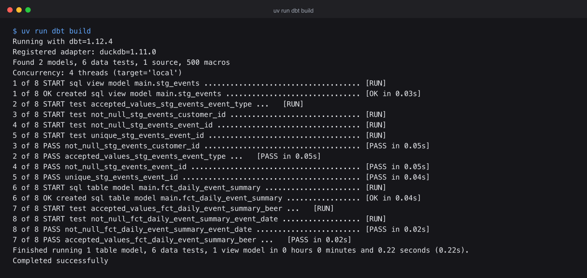
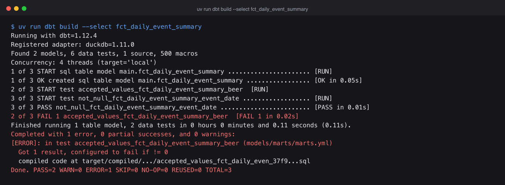
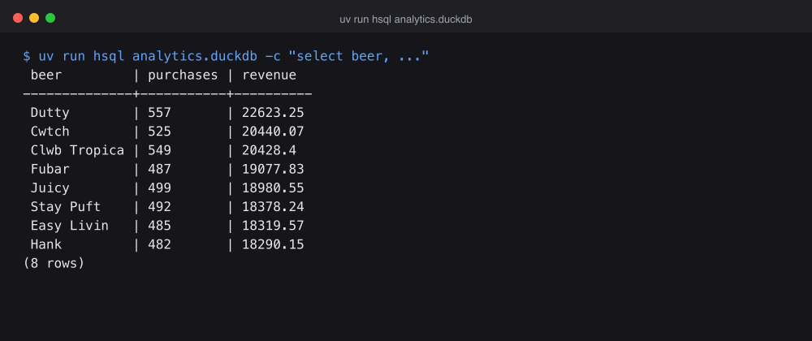

# Part 2 — DuckDB and DBT: Bringing rigour and environments to your delightful local data engineering

Time to increment to the next level now we have completed [part 1](./1.duckdb_harlequin.md), which tantalised us with a better future of non-hair tearing data engineering development on our local machines. These next steps will allow you to bring environmental awareness and pipeline testing to your setup - with duckdb and dbt!

- [Part 2 — DuckDB and DBT: Bringing rigour and environments to your delightful local data engineering](#part-2--duckdb-and-dbt-bringing-rigour-and-environments-to-your-delightful-local-data-engineering)
  - [Pre-Requisites](#pre-requisites)
  - [Installation](#installation)
    - [DBT](#dbt)
  - [Initialising DBT Project](#initialising-dbt-project)
    - [DBT Directories and Files I need to Know Right Now](#dbt-directories-and-files-i-need-to-know-right-now)
      - [Models](#models)
      - [dbt\_project.yml](#dbt_projectyml)
      - [profiles.yml](#profilesyml)
  - [Models Setup](#models-setup)
    - [Stable Source with Dynamic Location](#stable-source-with-dynamic-location)
    - [Create Stable Views](#create-stable-views)
    - [Add Model Tests](#add-model-tests)
  - [Local Dev Loop](#local-dev-loop)
  - [Harlequin on a Real Database](#harlequin-on-a-real-database)
  - [When Tests Bite](#when-tests-bite)
  - [hsql on the Mart](#hsql-on-the-mart)
  - [Shortcomings and Next Steps](#shortcomings-and-next-steps)

## Pre-Requisites

- [Part 1](./1.duckdb_harlequin.md) completed, with the fake beer events generated under `data/raw/events/`
- [uv](https://docs.astral.sh/uv/) for python and package management
- A terminal

## Installation

All we have to do to bring dbt into the mix is run the following command:

```bash
uv add dbt-duckdb
```

What did you have me install this time datagriff? Well hungovercoder we all know and love duckdb now, so what is dbt?

### DBT

DBT stands for data build tool. It is a framework for turning a pile of SQL select statements into a proper pipeline. You write each step as a plain `select`, sprinkle in a bit of [jinja](https://jinja.palletsprojects.com/) to reference other steps, and dbt works out the order to run them in, creates the views and tables for you, and tests the results. It also knows about environments, so the same SQL can point at your laptop today and the cloud tomorrow.

That's everything our little part 1 pipeline was missing. Our `run_pipeline.py` was a for loop over two files in a hard-coded order with hard-coded paths and no idea whether the data coming out was any good. dbt gives us all of that for the price of a few yaml files.

[dbt-duckdb](https://github.com/duckdb/dbt-duckdb) is the adapter that lets dbt talk to duckdb. Installing it pulls in dbt-core too, so this one command is all we need.

## Initialising DBT Project

Next run the following command:

```bash
uv run dbt init
```

Which will ask for some details to start your dbt project. I called mine `analytics_engineering` and picked duckdb as the database:


You'll then get a gnarly looking and obviously far more professional (and complicated!) directory layout compared to our first iteration. Hold on there reader, it'll be worth it.

### DBT Directories and Files I need to Know Right Now

Keeping in the spirit of simplicity, we're going to focus on only what we need right now to get going. Delete the analyses, macros, seeds, snapshots and tests directories, along with the starter README. You can look at the [dbt docs](https://docs.getdbt.com/docs/build/projects) for more information on what they're all for. Your dbt directory structure should look something like this now:

```txt
analytics_engineering/
├── models/
├── dbt_project.yml
└── profiles.yml
```

That's much more like it.

#### Models

This is where our SQL lives. Every `.sql` file in here is a model - a single `select` statement that dbt turns into a view or a table named after the file. The yaml files sitting next to them describe the models and hold their tests.

#### dbt_project.yml

The project config. Update yours to look like this:

```yaml
name: analytics_engineering
version: "1.0.0"
config-version: 2
profile: analytics_engineering
model-paths: ["models"]

models:
  analytics_engineering:
    staging:
      +materialized: view
    marts:
      +materialized: table
```

The bit worth knowing is the `models` block at the bottom. It sets how each folder of models gets materialised. Staging models become views, which only store the query and read the parquet fresh every time. Marts become tables, which store the actual results inside our duckdb file. Remember the in-memory session from part 1 that forgot everything when we closed harlequin? This is the fix.

#### profiles.yml

This tells dbt where to connect. `dbt init` puts this in your home directory by default, but I like to keep it in the project so everything is in source control. Create `analytics_engineering/profiles.yml` with the following:

```yaml
analytics_engineering:
  target: "{{ env_var('DBT_TARGET', 'local') }}"
  outputs:
    local:
      type: duckdb
      path: analytics.duckdb
      schema: main
      threads: 4
      extensions:
        - parquet
```

We've only got one target called `local`, which writes to an `analytics.duckdb` file. The `DBT_TARGET` environment variable picks which target to use and defaults to local.

This will become important for when we want to deploy to a new environment - coming in part 3!

## Models Setup

Our models directory should end up looking something like this for the demo:

```txt
models/
├── sources/
│   └── raw_sources.yml
├── staging/
│   ├── stg_events.sql
│   └── staging.yml
└── marts/
    ├── fct_daily_event_summary.sql
    └── marts.yml
```

### Stable Source with Dynamic Location

In models/sources add the following code to the file raw_sources.yml:

```yaml
version: 2

sources:
  - name: raw
    tables:
      - name: events
        config:
          external_location: "{{ env_var('EVENTS_LOCATION', '../data/raw/events/*.parquet') }}"
```

This starts adding the environmental awareness in to our dbt setup. We can now reference a table called events consistently in our other scripts but the actual location can change now per environment based on the environment variable. This means we can use a local directory for local development in `EVENTS_LOCATION` and later use say an AWS S3 url for dev and production.

The default path starts with `../` because we run dbt from inside the `analytics_engineering` directory and our data lives one level up.

### Create Stable Views

In models/staging add the following code to the file stg_events.sql:

```sql
select
  event_id,
  cast(event_timestamp as timestamp) as event_timestamp,
  cast(event_timestamp as date) as event_date,
  customer_id, session_id,
  lower(event_type) as event_type,
  beer,
  lower(device) as device,
  upper(country) as country,
  cast(revenue as double) as revenue
from {{ source('raw', 'events') }}
where event_id is not null and customer_id is not null
```

In models/marts add the following code to the file fct_daily_event_summary.sql:

```sql
select
  event_date, event_type, beer, device, country,
  count(*) as event_count,
  count(distinct customer_id) as unique_customers,
  count(distinct session_id) as unique_sessions,
  sum(revenue) as revenue
from {{ ref('stg_events') }}
group by 1,2,3,4,5
```

Look familiar? These are our two part 1 SQL files with the `COPY ... TO` plumbing stripped out. No more file paths, no more caring about run order. `source('raw', 'events')` points at our source and `ref('stg_events')` points at the staging model, and from those dbt knows the mart has to wait for staging.

We can see the chain of dynamic locations and variable referenced object names really becoming useful now.

### Add Model Tests

In models/staging add the following code to the file staging.yml:

```yaml
version: 2

models:
  - name: stg_events
    columns:
      - name: event_id
        data_tests: [not_null, unique]
      - name: customer_id
        data_tests: [not_null]
      - name: event_type
        data_tests:
          - accepted_values:
              arguments:
                values:
                  - page_view
                  - search
                  - product_view
                  - add_to_cart
                  - checkout_started
                  - purchase
```

And in models/marts add the following code to the file marts.yml, so we know no rogue beers have snuck into our shop:

```yaml
version: 2

models:
  - name: fct_daily_event_summary
    columns:
      - name: event_date
        data_tests: [not_null]
      - name: beer
        data_tests:
          - accepted_values:
              arguments:
                values:
                  - Cwtch
                  - Stay Puft
                  - Clwb Tropica
                  - Easy Livin
                  - Hank
                  - Fubar
                  - Juicy
                  - Dutty
```

These are dbt's built in generic tests. `not_null` and `unique` do what they say on the can, and `accepted_values` fails if a column has anything outside the list. Nulls don't count against `accepted_values`, which is handy as page views and searches don't have a beer.

## Local Dev Loop

Run this now for your local dev loop from inside the `analytics_engineering` directory:

```bash
cd analytics_engineering
export DBT_PROFILES_DIR="$(pwd)"
export DBT_TARGET=local
export EVENTS_LOCATION="../data/raw/events/*.parquet"

uv run dbt debug
uv run dbt build
```

`dbt debug` checks your profile and connection are happy. `dbt build` then runs every model and every test in dependency order - staging view, staging tests, mart table, mart tests. If a staging test fails, the mart downstream of it gets skipped rather than built on bad data.



Eight green passes. Two models and six tests in under a second, on a laptop, with no cluster in sight.

## Harlequin on a Real Database

Now for the persistence we promised in part 1. Open harlequin against the duckdb file dbt just built:

```bash
uv run harlequin analytics.duckdb
```

Open the catalog on the left and there they are in the `main` schema - `stg_events` as a view and `fct_daily_event_summary` as a table. Close harlequin, open it again, and they're still there. Lets see which beers are paying the bills:

```sql
select beer, sum(event_count) as purchases, round(sum(revenue),2) as revenue
from fct_daily_event_summary
where event_type = 'purchase'
group by beer
order by revenue desc;
```

No `read_parquet`, no file paths, just a table name.

Honest moment here. My first go at this used `schema: analytics` in `profiles.yml`, and the moment I queried it duckdb threw an "ambiguous reference" error at me. The database file is called `analytics.duckdb`, so duckdb names the catalog `analytics` too, and it couldn't tell which `analytics` I meant. I spent longer than I'd like to admit typing `analytics.analytics.fct_daily_event_summary` before switching to the `main` schema. Learn from my pain.

Run harlequin from inside `analytics_engineering` too. The `stg_events` view stores the relative `../data/raw/events` path, so it'll only find the parquet files from the same place dbt ran.

## When Tests Bite

Tests that always pass are just decoration, so lets break one. Remove `Dutty` from the beer list in `marts.yml` and build only the mart:

```bash
uv run dbt build --select fct_daily_event_summary
```



There it is. One failure, the exact test that failed, and the compiled SQL in `target/compiled` if you want to see which rows upset it. Paste that SQL into harlequin and you'll find Dutty sitting there. In a real pipeline that's a new beer launched without anyone telling the data team, and you'd rather find out here than from the finance meeting. Put Dutty back and run the build again to go green.

## hsql on the Mart

hsql from part 1 works against the duckdb file too, which is perfect for quick checks in the terminal or for an agent poking at your data:

```bash
uv run hsql analytics.duckdb \
  -c "select beer, sum(event_count) as purchases, round(sum(revenue),2) as revenue from fct_daily_event_summary where event_type = 'purchase' group by beer order by revenue desc;"
```



Dutty top of the pile. Can't argue with that.

## Shortcomings and Next Steps

We've now got persistence, environment variables doing the heavy lifting for our source location, and tests guarding our data. All still running happily on a laptop with the delightful tools from part 1. Would I use this setup for real? For a small team or a side project, absolutely - it's the setup I'd want on day one. For anything with more than a handful of people writing models, I'd add CI running `dbt build` on every pull request before going any further.

The obvious shortcoming is that it all still lives on my machine. In part 3 we'll point `EVENTS_LOCATION` at S3, add a new target to `profiles.yml` and get this pipeline running as a deployed job - same SQL, same tests, different environment. If I did this bit again I'd create `profiles.yml` in the project from the start rather than letting `dbt init` squirrel it away in my home directory.

To see the most up to date version of this code check out the repo at [github.com/hungovercoders/learn.harlequin](https://github.com/hungovercoders/learn.harlequin). Crack open a can and watch this space for part three.
