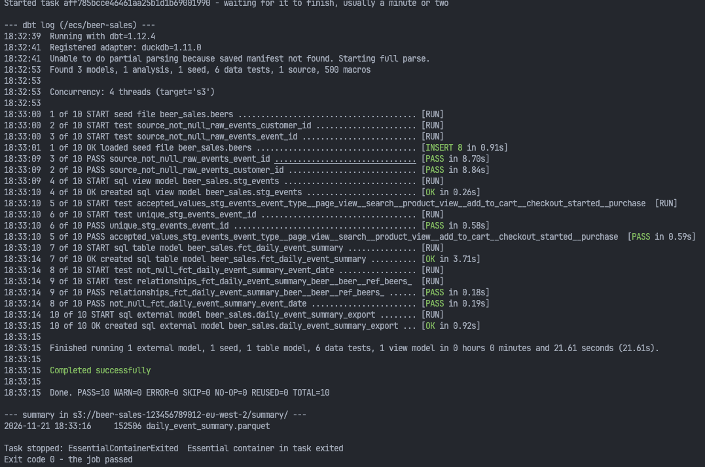

# Part 3 — DuckDB, dbt and AWS: Deploying the same pipeline without rewriting it

Time to cash in on the hard work from [part 2](./2.dbt.md). We put the location of our data behind an environment variable and promised that moving to the cloud would be a change of configuration and not a rewrite. Today we find out if that was true, by climbing three rungs - my laptop, a throwaway AWS on my laptop, and then a real AWS account - with the same SQL, the same tests and the same container on every one.

- [Part 3 — DuckDB, dbt and AWS: Deploying the same pipeline without rewriting it](#part-3--duckdb-dbt-and-aws-deploying-the-same-pipeline-without-rewriting-it)
  - [Pre-Requisites](#pre-requisites)
  - [The Three Rungs](#the-three-rungs)
  - [Make the Output Dynamic Too](#make-the-output-dynamic-too)
  - [A Job, Not a Server](#a-job-not-a-server)
  - [Rung 1 - The Container on my Laptop](#rung-1---the-container-on-my-laptop)
  - [Rung 2 - A Throwaway AWS with AWS Emulator](#rung-2---a-throwaway-aws-with-aws-emulator)
    - [Start the Emulator](#start-the-emulator)
    - [An Emulator Target](#an-emulator-target)
    - [The Infrastructure](#the-infrastructure)
    - [Apply it to the Emulator](#apply-it-to-the-emulator)
    - [dbt Against Emulated S3](#dbt-against-emulated-s3)
    - [The Same Container Against Emulated S3](#the-same-container-against-emulated-s3)
    - [Where the Emulator Stops](#where-the-emulator-stops)
  - [Rung 3 - Real AWS](#rung-3---real-aws)
    - [An S3 Target](#an-s3-target)
    - [Least Privilege](#least-privilege)
    - [Deploy It](#deploy-it)
    - [See it All in One Place](#see-it-all-in-one-place)
    - [Getting Told When it Fails](#getting-told-when-it-fails)
    - [Tidy Up](#tidy-up)
  - [Shortcomings and Next Steps](#shortcomings-and-next-steps)
    - [Why Not Airflow?](#why-not-airflow)
    - [The Series in One Table](#the-series-in-one-table)

## Pre-Requisites

- [Part 2](./2.dbt.md) completed, with a green `dbt build` in the `beer_sales` directory
- [uv](https://docs.astral.sh/uv/) for python and package management
- [Docker](https://docs.docker.com/get-docker/) to build and run the job
- [Terraform](https://developer.hashicorp.com/terraform/install) to describe the infrastructure
- The [AWS CLI](https://docs.aws.amazon.com/cli/latest/userguide/getting-started-install.html)
- [AWS Emulator](https://github.com/aws/aws-emulator) for the middle rung, which wants Linux or WSL
- An AWS account, but only for the very last rung

As before, generate a fresh batch of fake events from the repo root:

```bash
rm -rf data/raw/events
uv run python scripts/generate_fake_events.py
```

## The Three Rungs

Here is the whole post in one picture. The only things that change as we climb are where the parquet lives and who is running the container.

```txt
RUNG 1                     RUNG 2                      RUNG 3
my laptop                  AWS Emulator                real AWS

data/raw/events/           s3:// on 127.0.0.1          s3:// in eu-west-2
       \                        |                          /
        \                       |                         /
         +------------ source('raw','events') -----------+
                                |
                           stg_events
                                |
                     fct_daily_event_summary
                                |
                    daily_event_summary_export
                                |
docker run                 docker run                  Fargate task
target: local              target: emulator            target: s3
```

Why bother with the middle rung? Because the gap between "works on my laptop" and "works in an account with a bill attached" is where the embarrassing mistakes live. A wrong bucket path, a typo in the Terraform, a secret that doesn't load. I'd rather find those for free.

## Make the Output Dynamic Too

In part 2 our marts became tables inside `beers.duckdb`. That was the persistence we wanted on a laptop, but a deployed job is thrown away the moment it finishes and the duckdb file goes with it. If the results are going to outlive the job they need writing somewhere else.

dbt-duckdb has an `external` materialisation for exactly this. In models add a new `exports` directory, and in it the file daily_event_summary_export.sql:

```sql
{{
  config(
    materialized='external',
    format='parquet',
    location=env_var('SUMMARY_LOCATION', '../data/daily_event_summary.parquet')
  )
}}

select *
from {{ ref('fct_daily_event_summary') }}
```

It's the same trick as `EVENTS_LOCATION` but pointing the other way. Locally the summary lands as a parquet file next to our raw data, and in the cloud `SUMMARY_LOCATION` will point at a bucket.

Run the build from the `beer_sales` directory and we now have ten passes where we had nine:

```bash
cd beer_sales
export DBT_PROFILES_DIR="$(pwd)"
uv run dbt build
```

```txt
Done. PASS=10 WARN=0 ERROR=0 SKIP=0 NO-OP=0 REUSED=0 TOTAL=10
```

One honest moment here. My first go pointed the default at `../data/exports/` and dbt fell over with `Cannot open file ... No such file or directory`. DuckDB will happily write a file but it won't create the folder for you, so the default sits in `data/`, which we know exists.

## A Job, Not a Server

DuckDB is embedded. There is no database server to deploy, patch or pay for while it sits idle. The thing we put in production is just a program that starts, runs `dbt build` and stops - so a container is all we need.

In the repo root add a Dockerfile:

```dockerfile
FROM python:3.12-slim

RUN pip install --no-cache-dir uv

WORKDIR /app

# Install dependencies first so this layer is cached until the lockfile changes.
COPY pyproject.toml uv.lock .python-version ./
RUN uv sync --frozen --no-install-project

COPY beer_sales ./beer_sales

WORKDIR /app/beer_sales
ENV DBT_PROFILES_DIR=/app/beer_sales

CMD ["uv", "run", "--frozen", "dbt", "build"]
```

The same `uv.lock` that builds my laptop builds the image, and the last line is the exact command we've been typing since part 2. Add a `.dockerignore` too, so our data, our local duckdb file and the virtual environment stay out of the image:

```txt
.git
.venv
data
docs
raw_docs
**/*.duckdb
**/*.duckdb.wal
**/target
**/logs
**/dbt_packages
**/.env
**/.user.yml
```

## Rung 1 - The Container on my Laptop

From the repo root, build the image and run it with our local data mounted in:

```bash
docker build -t beer-sales .
docker run --rm -v "$(pwd)/data:/app/data" beer-sales
```

```txt
Done. PASS=10 WARN=0 ERROR=0 SKIP=0 NO-OP=0 REUSED=0 TOTAL=10
```

Ten passes again, and `data/daily_event_summary.parquet` written by the container. Nothing about AWS yet, and that's the point. This is the production job, and it runs on my laptop with one command.

Remember breaking a test in part 2 by taking Dutty off the beer list? Do the same to the container and look at what it hands back:

```bash
docker run --rm -v "$(pwd)/data:/app/data" beer-sales
echo $?
```

```txt
Done. PASS=9 WARN=0 ERROR=1 SKIP=0 NO-OP=0 REUSED=0 TOTAL=10
1
```

A failing test makes the container exit with a `1`. Hold that thought, as it's what will send us an email later.

Look closely at that line though. Nine passes and nothing skipped, which means the export still ran even though a test on the mart failed. dbt only holds a model's children back for tests that depend on that model alone, and our `relationships` test depends on the seed as well. So a rogue beer fails the job, but its numbers still reach the summary file. Good to know before you trust the file more than the exit code.

## Rung 2 - A Throwaway AWS with AWS Emulator

[AWS Emulator](https://github.com/aws/aws-emulator) is one program from AWS that answers the AWS APIs on a local port. No account, no fee, and it forgets everything when it stops. I used it for the [software factory template](https://github.com/hungovercoders/template-aws-api) and wanted to know how far it would carry a data pipeline.

### Start the Emulator

With the emulator installed, start it in a terminal of its own and leave it running:

```bash
aws-emulator -p 9297
```

It writes a set of credentials, a config file and a certificate for this run to `~/.aws/emulator/9297/`. Everything that talks to AWS needs pointing at those, so the repo has a little script to do it. In scripts add emulator_env.sh:

```bash
EMULATOR_PORT="${EMULATOR_PORT:-9297}"
EMULATOR_DIR="$HOME/.aws/emulator/$EMULATOR_PORT"

export AWS_ENDPOINT_URL="https://127.0.0.1:$EMULATOR_PORT"
export AWS_SHARED_CREDENTIALS_FILE="$EMULATOR_DIR/emulator_credentials"
export AWS_CONFIG_FILE="$EMULATOR_DIR/config"
export AWS_CA_BUNDLE="$EMULATOR_DIR/ca.pem"
export AWS_REGION=us-east-1
export AWS_DEFAULT_REGION=us-east-1
export AWS_EC2_METADATA_DISABLED=true
export AWS_DISABLE_HOST_PREFIX_INJECTION=true

# Real credentials in the shell would win over the emulator's, so they go.
unset AWS_ACCESS_KEY_ID AWS_SECRET_ACCESS_KEY AWS_SESSION_TOKEN AWS_PROFILE
```

Then in a second terminal, from the repo root:

```bash
source scripts/emulator_env.sh
aws sts get-caller-identity
```

```txt
{
    "UserId": "AIDAH5I7GEMO7ADXNFAZU",
    "Account": "000000000000",
    "Arn": "arn:aws:iam::000000000000:user/emulator"
}
```

Account `000000000000`. We're talking to the emulator.

That last `unset` line is another honest moment. The first time round every call came back with `Sign the request with the emulator credentials`, because real AWS keys were sitting in the shell's environment and they beat the emulator's credentials file. A handy failure really - better refused by the emulator than quietly sent to a real account.

### An Emulator Target

Part 2 left us with one target in `profiles.yml` called `local`. Add a second one underneath it:

```yaml
    emulator:
      type: duckdb
      path: beers.duckdb
      schema: beer_sales
      threads: 4
      extensions:
        - parquet
        - httpfs
        - aws
      settings:
        # DuckDB does not read AWS_CA_BUNDLE, so it is told where the emulator's certificate is.
        ca_cert_file: "{{ env_var('AWS_CA_BUNDLE', '') }}"
      secrets:
        - type: s3
          provider: credential_chain
          region: "{{ env_var('AWS_REGION', 'us-east-1') }}"
          endpoint: "{{ env_var('EMULATOR_HOST', '127.0.0.1:9297') }}"
          url_style: path
          use_ssl: true
```

Two new extensions do the work. `httpfs` teaches duckdb to read and write `s3://` paths, and `aws` lets it find credentials the same way the AWS CLI does - that's the `credential_chain` provider. There are no keys in this file and there never will be.

The rest is the emulator's address. It serves HTTPS with its own certificate, so duckdb needs telling where that certificate is.

### The Infrastructure

The whole deployment is one Terraform file, `infra/main.tf` in the repo. It's the same file for the emulator and for real AWS. Here's what's in it and why:

| Resource | What it's for |
| --- | --- |
| S3 bucket | Raw events in under `raw/events/`, the summary out under `summary/` |
| ECR repository | Holds our Docker image |
| ECS cluster | A free, empty container for Fargate tasks - no servers behind it |
| ECS task definition | The image, its size and the environment variables from part 2 |
| CloudWatch log group | Where the `dbt build` output lands |
| Task role | What dbt runs as - it can read the events and write the summary, nothing else |
| Task execution role | Lets ECS pull the image and write the logs |
| Scheduler role | Lets the schedule start the task |
| EventBridge schedule | Runs the job at six every morning |
| Security group | Outbound only, nothing can call in |
| SNS topic and EventBridge rule | Tells us when the job fails |
| Resource group | One page in the console showing everything above, found by its tags |

There's no ECS service and no load balancer, because this is a job that runs to completion and not a thing that sits waiting for requests. The task runs in the account's default VPC with a public IP so it can reach ECR and S3 directly. Put it in a private subnet and you'll need a NAT gateway, which costs far more each month than this job ever will.

The part that ties back to part 2 is the task definition's environment. These are the very same variables we've been exporting by hand:

```hcl
environment = [
  { name = "DBT_TARGET", value = "s3" },
  { name = "AWS_REGION", value = var.region },
  { name = "EVENTS_LOCATION", value = local.events_location },
  { name = "SUMMARY_LOCATION", value = local.summary_location },
]
```

### Apply it to the Emulator

Still in the terminal where we sourced the emulator script:

```bash
terraform -chdir=infra init
terraform -chdir=infra apply -state=emulator.tfstate \
  -var bucket_name=beer-sales-local -var region=us-east-1
```

```txt
Apply complete! Resources: 18 added, 0 changed, 0 destroyed.

Outputs:

bucket = "beer-sales-local"
ecr_repository_url = "127.0.0.1:9297/beer-sales"
events_location = "s3://beer-sales-local/raw/events/*.parquet"
summary_location = "s3://beer-sales-local/summary/daily_event_summary.parquet"
```

Eighteen resources in a few seconds, on a laptop, for nothing. The emulator's state gets its own file so it never mixes with the real thing later. As the emulator forgets everything when it stops, delete `infra/emulator.tfstate` each time you restart it.

It didn't go that smoothly the first time. Two things bit:

- The bucket. A plain `aws_s3_bucket` sat at `Still creating...` until I gave up on it. The AWS provider reads a bucket's tags through a service the emulator doesn't have. The fix is to make the bucket with `awscc_s3_bucket` instead, which goes through Cloud Control and works on both the emulator and real AWS. The price is that it has no `force_destroy`, so the bucket needs emptying before it can be deleted.
- The security group. On the emulator version I started with, the outbound rule failed as a duplicate. The newest release had already fixed it. The emulator is days old and moving fast, so check you're on a recent one before blaming your Terraform. This post was run on 1.0.545.

### dbt Against Emulated S3

Now the moment of truth for part 2. Copy the events into the emulated bucket:

```bash
aws s3 sync data/raw/events s3://beer-sales-local/raw/events/
```

Then run the build with nothing changed but three environment variables:

```bash
cd beer_sales
export DBT_PROFILES_DIR="$(pwd)"
export DBT_TARGET=emulator
export EVENTS_LOCATION="s3://beer-sales-local/raw/events/*.parquet"
export SUMMARY_LOCATION="s3://beer-sales-local/summary/daily_event_summary.parquet"

uv run dbt build
```

```txt
Done. PASS=10 WARN=0 ERROR=0 SKIP=0 NO-OP=0 REUSED=0 TOTAL=10
```

```bash
aws s3 ls s3://beer-sales-local/summary/
```

```txt
2026-11-20 21:57:04     153141 daily_event_summary.parquet
```

Ten passes, the events read from a bucket and the summary written back to one. Not a single line of SQL changed. That's the payoff for putting the environment differences at the edges in part 2.

### The Same Container Against Emulated S3

Running dbt from my shell is one thing. What gets deployed is the container, so lets point that at the emulator too. Rebuild the image so it has the new target, then from the repo root:

```bash
cd ..
docker build -t beer-sales .
docker run --rm --network host \
  -e DBT_TARGET=emulator \
  -e AWS_REGION \
  -e AWS_CA_BUNDLE=/emulator/ca.pem \
  -e AWS_SHARED_CREDENTIALS_FILE=/emulator/emulator_credentials \
  -e EVENTS_LOCATION \
  -e SUMMARY_LOCATION \
  -v "$HOME/.aws/emulator/9297:/emulator:ro" \
  beer-sales
```

```txt
Done. PASS=10 WARN=0 ERROR=0 SKIP=0 NO-OP=0 REUSED=0 TOTAL=10
```

`--network host` lets the container reach the emulator on `127.0.0.1`, and the mount hands it the emulator's certificate and credentials. Everything else is the image exactly as it will ship.

### Where the Emulator Stops

I wanted the emulator to run the Fargate task too, and I tried quite hard. It won't, and it's worth being straight about why.

- Pushing the image to the emulator's ECR fails with `the operation is unsupported`. Without an image the task stops with `CannotPullContainerError`.
- So I pointed a task at a public image instead. It went to `RUNNING`, logged an `echo` and returned my exit code, which looked like a win. Then `python --version` printed nothing and sat there forever, and `cat /etc/os-release` said the file didn't exist. The emulator plays out the life of a task but it doesn't run what's inside the image.
- A Lambda was the last idea. The emulator's Python turns out to be a stand-in written in Rust, with no filesystem, no native libraries and no child processes. DuckDB is a native library, so that was that.

None of this is a complaint. The emulator answers the AWS APIs, it isn't somewhere to run programs. So the split is simple - Docker brings the compute, the emulator brings the S3. Between them they've proved the Terraform applies, the job reads and writes a bucket, and the image works. What they can't prove is what only AWS can show: the image being pulled, the schedule firing, the task's permissions and the alert arriving. The emulator's own guide says not to test security on it either.

## Rung 3 - Real AWS

<!-- TODO: this rung has not been run against a real account yet. The commands are written from the Terraform and need running, and the screenshots below need taking, before this is published. -->

Close the emulator terminal and open a fresh one, so none of the emulator's settings follow us up the ladder.

### An S3 Target

One last target in `profiles.yml`, and it's the emulator one with the emulator taken out:

```yaml
    s3:
      type: duckdb
      path: beers.duckdb
      schema: beer_sales
      threads: 4
      extensions:
        - parquet
        - httpfs
        - aws
      secrets:
        - type: s3
          provider: credential_chain
          region: "{{ env_var('AWS_REGION', 'eu-west-2') }}"
```

The `credential_chain` is doing something quite lovely here. On my laptop it finds my SSO login. Inside Fargate it finds the task's role. Same line of config, and no key is ever written down anywhere - not in SQL, not in `profiles.yml`, not in the image and not in git.

### Least Privilege

The task role is what dbt runs as, and it gets exactly what the job needs:

```hcl
statement {
  actions   = ["s3:ListBucket"]
  resources = [awscc_s3_bucket.data.arn]
  condition {
    test     = "StringLike"
    variable = "s3:prefix"
    values   = ["raw/events/*", "summary/*"]
  }
}

statement {
  actions   = ["s3:GetObject"]
  resources = ["${awscc_s3_bucket.data.arn}/raw/events/*"]
}

statement {
  actions   = ["s3:GetObject", "s3:PutObject", "s3:AbortMultipartUpload"]
  resources = ["${awscc_s3_bucket.data.arn}/summary/*"]
}
```

It can list and read the raw events, and read and write the summary. It can't delete anything and it can't touch any other bucket. The emulator never checked any of this, so the first real run is the first real test of it.

### Deploy It

Log in and apply the same Terraform:

```bash
aws sso login --profile my-profile
export AWS_PROFILE=my-profile
export AWS_REGION=eu-west-2

terraform -chdir=infra apply -var alert_email=me@example.com
export BUCKET=$(terraform -chdir=infra output -raw bucket)
```

Bucket names have to be unique across the whole of AWS, so unless you pass a `bucket_name` of your own Terraform makes one from your account id and region, like `beer-sales-123456789012-eu-west-2`.

Push the image to the repository Terraform just made. If you're on an Apple Silicon Mac add `--platform linux/amd64` to the build, as the task runs on x86:

```bash
REPO=$(terraform -chdir=infra output -raw ecr_repository_url)
aws ecr get-login-password --region eu-west-2 \
  | docker login --username AWS --password-stdin "${REPO%%/*}"
docker build -t "$REPO:latest" .
docker push "$REPO:latest"
```

Put the events in the bucket:

```bash
aws s3 sync data/raw/events "s3://$BUCKET/raw/events/"
```

And rather than wait for six in the morning, run the job now. Terraform prints the command for us:

```bash
eval "$(terraform -chdir=infra output -raw run_task_command)"
```

A minute or two later the task has been and gone. Here is its log from CloudWatch and the summary file it left in the bucket:



Ten passes with `target='s3'`, on a machine that didn't exist two minutes earlier and doesn't exist now. The first time I ran this for real it worked - the image pulled, the task's role was allowed to read and write exactly what it needed, and the summary landed in the bucket.

### See it All in One Place

A dozen resources spread over half a dozen AWS services is a lot to keep in your head. Every resource Terraform makes is tagged with the project and its environment:

```hcl
tags = {
  project     = local.name
  environment = var.environment
  managed-by  = "terraform"
}
```

And a resource group is a saved search for those tags. Open Resource Groups in the console and `beer-sales-production` lists the lot on one page, or ask for it from the terminal:

```bash
aws resource-groups list-group-resources --group-name beer-sales-production \
  --query 'Resources[].Identifier.[ResourceType,ResourceArn]' --output text
```

<!-- TODO: screenshot of the beer-sales-production resource group in the console, with the account id cropped out -->

A second environment is then one variable away. The names in this post are fixed, so it would need a second account or region, but the tag and the group are ready for it.

### Getting Told When it Fails

Remember the container exiting with a `1` when a test failed? That's all the alerting needs. An EventBridge rule watches for our task stopping with anything other than a zero, or failing to start at all, and sends a message to an SNS topic:

```hcl
event_pattern = jsonencode({
  source      = ["aws.ecs"]
  detail-type = ["ECS Task State Change"]
  detail = {
    clusterArn = [aws_ecs_cluster.this.arn]
    lastStatus = ["STOPPED"]
    "$or" = [
      { containers = { exitCode = [{ anything-but = 0 }] } },
      { stopCode = ["TaskFailedToStart"] },
    ]
  }
})
```

Pass `alert_email` to the apply, as we did above, and that address is subscribed to the topic. AWS sends a confirmation email first and nothing arrives until you click it.

To see it work, break a test on purpose. Take Dutty off the beer list again, push the image and run the task.

<!-- TODO: screenshot of the failure email. The alert did not arrive on the emulator, so this is its first real test. -->

One gap to know about. If the schedule itself can't start the task there is no task to stop, so this rule never fires. A dead-letter queue on the schedule would catch that.

### Tidy Up

When you're done, empty the bucket and take it all down:

```bash
aws s3 rm "s3://$BUCKET" --recursive
terraform -chdir=infra destroy
```

If you'd rather not type all of that, `scripts/aws.sh` in the repo wraps this whole rung up - `deploy`, `run`, `break`, `fix` and `destroy`. It's worth doing by hand once though, so you know what it's doing for you.

## Shortcomings and Next Steps

We now have the same pipeline running in three places, and the only things that changed on the way up were a target name and two locations. The SQL from part 2 hasn't been touched. Is this worth it for real? For a daily batch job over files in a bucket I think it is a very sensible place to start. It costs next to nothing, there is no server to look after, and every piece of it can be run on a laptop first.

It has its limits. The image downloads duckdb's extensions each time it starts, which is one more thing that can be down on the day - they can be baked into the image if that worries you. The duckdb file is thrown away after every run, so anything you want to keep has to be exported like our summary. And it is one job. The day there are five of them that depend on each other, this stops being enough.

### Why Not Airflow?

A fair question at this point is why we haven't reached for something like Airflow. The honest answer is that they aren't really alternatives - the container is the thing that runs, and Airflow is something that decides when things run. If we adopted Airflow tomorrow it would most likely still be launching this exact image. What we have is one job, on one schedule, and dbt is already working out the order of the seeds, models and tests inside `dbt build`, so there is nothing left for an orchestrator to orchestrate. An Airflow environment also wants a scheduler, a web server and a metadata database running all month whether or not anything is happening, whereas our Fargate task costs nothing until it starts and nothing again once it stops. And the local story stays simple - `docker run` on my laptop is the production job. Airflow earns its place when the problem becomes coordination: several jobs that depend on each other, waiting on a file to land or another team's pipeline to finish, backfilling a range of dates, or a room full of people who all need to see what ran and what failed. Before that there is even a middle step in AWS Step Functions, which will chain a few tasks with retries and still cost nothing while idle. Add the complexity when it earns its place, not before - same rule as the rest of this series.

### The Series in One Table

| Part | What we added | Why |
| --- | --- | --- |
| [1](./1.duckdb_harlequin.md) | DuckDB, parquet and harlequin | Fast, enjoyable local development |
| [2](./2.dbt.md) | dbt | Tests, dependencies and locations that change per environment |
| 3 | A container, AWS Emulator and Fargate | Cloud storage and a scheduled job without rewriting the pipeline |

Make local development delightful first, add structure when it solves a real problem, and make the cloud a change of configuration. That's the series.

To see the most up to date version of this code check out the repo at [github.com/hungovercoders/learn.harlequin](https://github.com/hungovercoders/learn.harlequin). Crack open a can, you've earned it.
